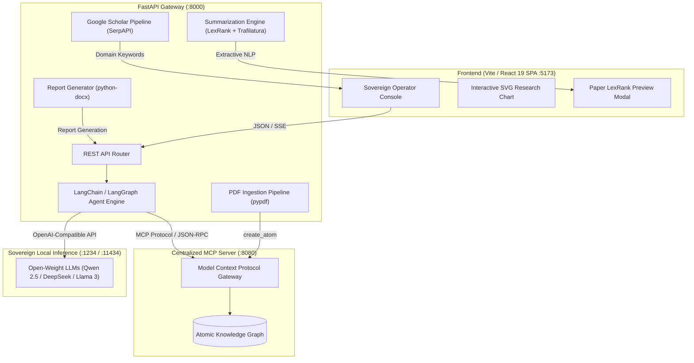

# Sovereign On-Premise Agentic AI Workbench
> **Using Open-Weight Multimodal LLMs for Confidential Industrial Work**

[](https://www.python.org/)
[](https://fastapi.tiangolo.com/)
[](https://react.dev/)
[](https://vitejs.dev/)
[](https://www.docker.com/)
[](LICENSE)

---

## 📌 Executive Summary

Modern industrial facilities (chemical refineries, manufacturing plants, critical energy infrastructure) generate immense volumes of proprietary technical literature, standard operating procedures (SOPs), and equipment specifications. Standard commercial cloud-hosted AI APIs violate strict air-gap compliance and risk exposing confidential operational intelligence.

The **Sovereign On-Premise Agentic AI Workbench** is an enterprise-grade, air-gapped knowledge platform that interfaces open-weight foundation models (such as **Qwen-2.5**, **DeepSeek**, and **Llama-3**) with a centralized **Atomic Knowledge Graph** using the **Model Context Protocol (MCP)**. It equips industrial plant engineers and technical operators with:

- **Sovereign Local Inference**: Eliminates data exfiltration risks by hosting models on-premise (via LM Studio, Ollama, or vLLM).
- **Centralized MCP Knowledge Graph**: Autonomous tool execution for semantic graph lookup (`semantic_search`, `get_wiki`, `create_atom`).
- **Technical Document Ingestion**: Converts complex industrial PDF documentation into graph atoms on the fly.
- **Academic Grounding**: Automatically extracts domain concepts and correlates findings with live Google Scholar literature.
- **Dynamic Research Coverage & Synthesis**: Visualizes literature density with interactive charts and performs instant client-side LexRank extractive summarization.
- **Deterministic Report Generation**: Compiles executive summaries and verified mathematical calculations into downloadable Word (`.docx`) collateral.

---

## 🏗 System Architecture



---

## ✨ Core Capabilities

| Capability | Technical Mechanism | Industrial Value |
| :--- | :--- | :--- |
| **Air-Gapped Sovereign AI** | Open-weight models deployed locally via LM Studio / Ollama | Zero confidential data leaves internal perimeter |
| **Agentic Tool Calling** | LangChain / LangGraph ReAct orchestration | Autonomous query resolution and tool routing |
| **Knowledge Graph Interface** | Model Context Protocol (MCP) JSON-RPC client | Structured entity search and cross-linking across plant assets |
| **Automated Collateral Ingestion** | Asynchronous multi-page PDF ingestion (`pypdf`) | Converts standard operating procedures into queryable graph nodes |
| **Research Grounding** | Concurrent SerpAPI Scholar querying + LexRank | Validates engineering decisions against peer-reviewed literature |
| **Auditable Execution Trace** | Granular chain-of-thought and tool step logging | Transparent verification of reasoning before plant deployment |

---

## 🛠 Technology Stack

- **Frontend**: React 19, TypeScript, Vite, Vanilla CSS with custom glassmorphic styling, responsive SVG data visualization.
- **Backend**: Python 3.11+, FastAPI, Uvicorn, AsyncIO, AIOHTTP.
- **Agentic Framework**: LangChain, LangGraph (`create_agent`), LangChain OpenAI.
- **Document Processing**: PyPDF, Python-docx, Trafilatura, Sumy, NLTK.
- **Containerization**: Docker, Docker Compose, Nginx.

---

## 🚀 How to Run the Application

You can run the workbench either **Locally (Bare Metal)** or with **Docker Compose**.

---

### Method 1: Local Development (Bare Metal)

#### Prerequisites
- **Node.js**: `v18+` or `v20+` (Run `node -v` to verify)
- **Python**: `3.10+` or `3.11+` (Run `python --version` to verify)

> 💡 Open **two terminals** and run both columns below at the same time.

<table>
<tr>
<td width="50%" valign="top">

#### 🐍 Step 1: Start the Backend
**(Terminal 1)**

1. Navigate to the backend:
   ```powershell
   cd backend
   ```

2. Create and activate a virtual environment:
   ```powershell
   python -m venv venv
   .\venv\Scripts\activate
   ```
   > If PowerShell shows a script execution policy error, run:
   > `Set-ExecutionPolicy -Scope Process -ExecutionPolicy Bypass`
   > then activate again.

3. Install backend dependencies:
   ```powershell
   pip install -r requirements.txt
   ```

4. Verify your environment file. The backend already includes a pre-configured `backend/.env` (LLM, MCP and port configuration). Inspect or modify it if needed.

5. Launch the backend API server:
   ```powershell
   python main.py
   ```

✅ Backend: **`http://localhost:8000`**
📖 API docs: **`http://localhost:8000/docs`**

</td>
<td width="50%" valign="top">

#### ⚛️ Step 2: Start the Frontend
**(Terminal 2)**

1. Open a **second** terminal and navigate to the frontend:
   ```powershell
   cd frontend
   ```

2. Install Node dependencies:
   ```powershell
   npm install
   ```

3. Start the Vite development server:
   ```powershell
   npm run dev
   ```

4. Open your browser and go to:
   ```
   http://localhost:5173
   ```

✅ Frontend: **`http://localhost:5173`**

</td>
</tr>
</table>

---

### Method 2: Running with Docker Compose (HTTPS, two-laptop demo)

Linux host. Nginx serves the UI and the API over TLS on port 443. The backend listens only on `127.0.0.1:8000`, so it is not reachable from the LAN. All model settings, inference endpoints, credentials, and security preferences are loaded from `backend/.env`.

1. Create the TLS certificates once, and again whenever the LAN IP changes:
   ```bash
   ./scripts/gen_tls_cert.sh 192.168.1.42   # your Wi-Fi/hotspot IP (hostname -I)
   ./scripts/gen_tls_cert.sh                # local mode: localhost only
   ```
2. Start:
   ```bash
   docker compose up -d --build
   ```
3. On the client laptop, trust `certs/ca/ca.crt` (never copy `ca.key`). Then open:
   - **Remote mode**: `https://<LAN_IP>/`
   - **Local mode**: `https://localhost/`
   - API: `https://<host>/api/...`. Swagger docs are available only on the server at `http://127.0.0.1:8000/docs`.

   Trust steps for Ubuntu and Windows, plus verification commands, are in [`docs/TLS_SETUP.md`](docs/TLS_SETUP.md).
4. Shut down:
   ```bash
   docker compose down
   ```

#### 🐳 Docker Compose Architecture & Standards
The [`docker-compose.yml`](file:///d:/Vaibhav%20Programs/Mini-Project%202/sovereign-industrial-workbench/docker-compose.yml) includes:
- **Centralized Environment Management**: Loads runtime variables via `env_file: ./backend/.env`, separating configuration from container definitions.
- **Cross-Platform Host Routing**: Configures `extra_hosts` mapping `host.docker.internal:host-gateway`, enabling containerized services to communicate with host-hosted inference engines (such as Ollama or LM Studio) across Windows, Linux, and macOS.
- **Zero-Secret Repository Hygiene**: Eliminates hardcoded tokens or API credentials in compose files.
- **Compose V2 Compliance**: Follows the modern Compose Specification without deprecated schema attributes.


---

## 🧠 Connecting Your LLM (Inference Options)

The workbench supports any OpenAI-compatible API endpoint via `backend/.env`:

### Option A: LM Studio (Recommended for Windows GUI)
1. Download and open [LM Studio](https://lmstudio.ai/).
2. Search and download an open-weight model (e.g. `Qwen2.5-7B-Instruct-GGUF` or `DeepSeek-R1-Distill-Qwen-7B`).
3. Click the **Developer / Local Server** tab (<-> icon).
4. Select your loaded model and click **Start Server** on port `1234`.
5. In `backend/.env`, set:
   ```env
   LLM_BASE_URL=http://localhost:1234/v1
   LLM_MODEL=qwen2.5-7b-instruct-1m
   LLM_API_KEY=1234
   ```

### Option B: Ollama (Recommended for Command-Line)
1. Install [Ollama](https://ollama.com/) and run:
   ```bash
   ollama run qwen2.5:7b
   ```
2. In `backend/.env`, set:
   ```env
   LLM_BASE_URL=http://localhost:11434/v1
   LLM_MODEL=qwen2.5:7b
   LLM_API_KEY=ollama
   ```

### Option C: Cloud Provider (OpenAI / Groq / OpenRouter)
If cloud access is permitted, you can point to any hosted provider:
```env
LLM_BASE_URL=https://api.openai.com/v1
LLM_MODEL=gpt-4o-mini
LLM_API_KEY=sk-your-openai-key-here
```

### Option D: Built-In Sovereign Air-Gapped Fallback
If no local LLM server is active, **the application will not crash**. The backend automatically activates its **Sovereign Air-Gapped Fallback mode**: it parses query concepts heuristically, executes Google Scholar retrieval, and provides a clear status notice.

---

## 💡 Step-by-Step Feature Walkthrough

Once both servers are running and you open `http://localhost:5173`:

1. **Authenticate Operator Session**:
   - On the login screen, enter an Operator ID (e.g., `operator.v_88`).
   - Click **Authenticate Session**. The backend issues an isolated clearance token.

2. **Modern Composer & Deep Research Toggle (DeepSeek-Style)**:
   - Features a card-based composer with an expansive auto-resizing textarea and dedicated actions toolbar.
   - Toggle **`🔬 Deep Research`** (inspired by DeepSeek's DeepThink mode) to activate external SerpAPI literature search. When toggled OFF, external API calls are completely bypassed for strict, lightning-fast on-premise execution.
   - Includes quick prompt starters for Heat Exchanger Calculations, Hydrocracker Safety Protocols, CKKS Homomorphic Encryption Audits, and Pinch Network Optimization.

3. **DeepSeek R1 Thought Process Trace**:
   - Agent responses include an interactive **`🧠 Thought Process`** drawer displaying reasoning latency, model trace, and decision steps before final synthesis.

4. **Dynamic Hardware & Inference Telemetry**:
   - The lower-left sidebar footer monitors real-time system performance:
     - **Inference Latency**: Updated dynamically on every query turn and diagnostic test (e.g., `0.85s/turn`).
     - **GPU Acceleration**: Detects CUDA devices, Apple Silicon Metal, or high-performance CPU SIMD offloading status (`100% VRAM Offload`).
     - Clicking the metrics card triggers an instant AST sandbox diagnostic check.

5. **Live Execution Sandbox Console**:
   - Located in the right sidebar with a live pulsing beacon (`● SANDBOX CONSOLE`).
   - Displays real-time streaming traces of AST mathematical evaluation, query dispatch, and document compilation.
   - Includes quick **Ping** and **Clear** controls directly on the terminal header.

6. **Active Knowledge Vault & Topology Inspector**:
   - Live indicator for centralized Atomic MCP connectivity and indexed atom counts.
   - Click **"Inspect"** or **"Knowledge Vault"** to open a detailed modal showing engine topology, endpoint status, and CKKS homomorphic encryption parameters.

7. **Explore Google Scholar Research Grounding**:
   - When **Deep Research** is enabled, the interactive **Research Coverage Chart** plots academic literature density across keywords.
   - Expand paper cards, view live summaries, and open the **LexRank Extractive Summary Modal**.

8. **Ingest Technical Documents (PDF to KG Atom)**:
   - Click **"Ingest Document"** in the sidebar to upload technical PDFs, which are converted to structured markdown chunks and indexed into the Knowledge Graph.

---

## ⚙️ Configuration Reference (`backend/.env`)

| Variable | Default Value | Description |
| :--- | :--- | :--- |
| `HOST` | `0.0.0.0` | Backend host binding |
| `PORT` | `8000` | Backend port |
| `LLM_BASE_URL` | `http://localhost:11434/v1` | OpenAI-compatible inference endpoint (Ollama / LM Studio / vLLM) |
| `LLM_MODEL` | `qwen2.5:3b` | Open-weight model name (e.g. `qwen2.5:3b`, `qwen2.5:7b`, `llama3:8b`, etc.) |
| `LLM_API_KEY` | `ollama` | API authorization key for inference endpoint |
| `MCP_URL` | `http://localhost:8080/mcp` | Centralized Atomic Model Context Protocol server URL |
| `MCP_AUTH_HEADER` | *(none; set in `backend/.env`)* | Authorization token for MCP server |
| `SERPAPI_KEY` | *(none; set in `backend/.env`)* | SerpAPI key for Google Scholar academic search. Leave empty for air-gapped use |
| `CORS_ALLOW_ORIGINS` | *(local origins)* | Exact CORS allow-list, comma separated. `SERVER_LAN_IP` adds `https://<LAN_IP>` |
| `VITE_API_URL` | `/api` | Frontend API base. Relative, proxied by Nginx (Docker) or Vite (dev) |
| `INGEST_INBOX_DIR` | `$ENCRYPTION_DATA_DIR/inbox` | Folder the agent's `ingest_pdf` tool may read (plain file names only) |
| `PDF_OCR_MIN_CHARS` | `50` | Pages with less pypdf text than this are OCR'd with Tesseract (`eng`). `0` disables OCR |
| `PDF_OCR_MAX_PAGES` | `0` | Maximum OCR'd pages per PDF; `0` = no limit |
| `PDF_VISION_ENABLED` | `false` | Describe pages that contain images with the local vision model; the description is stored under its own heading |
| `VISION_ALLOW_REMOTE` | `false` | Vision only runs when `LLM_BASE_URL` is a loopback address unless this is `true` |
| `VISION_MODEL` | `qwen2.5vl:3b` | Vision model name at `LLM_BASE_URL` |
| `VISION_TIMEOUT_S` | `60` | Per-page vision timeout; on timeout or no connection the rest is ingested text-only |
| `ROUTER_EMBED_FALLBACK` | `false` | Use embedding similarity when no keyword rule matches (rules: `backend/router_rules.json`) |
| `ROUTER_RULES_PATH` | `backend/router_rules.json` | Alternative router rules file |
| `SANDBOX_SOCKET` | `/ipc/runner.sock` | Unix socket of `sandbox-runner` (set by compose; no TCP) |
| `SANDBOX_IMAGE` / `SANDBOX_MAX_CONCURRENT` | `python:3.11-slim` / `2` | `sandbox-runner` settings in `docker-compose.yml` |
| `MCP_AUTH_HEADER` | `Bearer <token>` | Authorization token for Atomic MCP server |
| `SERPAPI_KEY` | *(optional)* | SerpAPI key for Google Scholar academic search (air-gapped fallback available) |
| `VITE_API_URL` | `http://localhost:8000` | Frontend backend gateway URL |

---

## 📡 Backend API Endpoints

| Endpoint | Method | Purpose |
| :--- | :--- | :--- |
| `GET /` | `GET` | Health check, active model, and runtime endpoint status |
| `POST /login` | `POST` | Authenticates operator username and issues session UUID |
| `POST /agent/query` | `POST` | Router (`route` field) picks the agent: coding gets only the sandbox tool; others get the knowledge/ingest tools. Returns `tool_calls` |
| `POST /agent/summarize` | `POST` | LexRank summary of a Scholar result link. Needs `token` (401 otherwise); every redirect hop is checked, and internal addresses are refused |
| `POST /agent/tool` | `POST` | Direct invocation of MCP Knowledge Graph tools |
| `POST /ingest/pdf` | `POST` | Multipart PDF/text upload. With encryption on: DP noise + CKKS + AES-GCM, then MCP atom ingestion |
| `POST /agent/verify-encryption` | `POST` | Encryption status, DP epsilon, encrypted atom count, audit-chain integrity |
| `POST /dummy_tool` | `POST` | Diagnostic Ping: runs `print(1+1)` in the isolated code sandbox and reports the result |

---

## 🔐 Encryption Layer (CKKS Homomorphic Search + Differential Privacy)

With `ENCRYPTION_ENABLED=true`, nothing readable reaches the Atomic knowledge graph:

- **Ingestion** (`POST /ingest/pdf`): text → page-aware chunks → local embeddings (`nomic-embed-text`) → Laplace DP noise → **CKKS encryption** (TenSEAL, N=8192). Chunk text and titles are sealed with **AES-256-GCM** before they are sent to Atomic.
- **Search** (`semantic_search_encrypted` tool, also run automatically inside `POST /agent/query`): the query is embedded, noised and CKKS-encrypted. An evaluator holding only the *public* context computes encrypted similarity scores. Only the top-K results are decrypted, at the response boundary. Atomic is not contacted during search.
- **Audit**: an HMAC-chained JSONL log of every encrypt, compute and decrypt event, with no plaintext. `POST /agent/verify-encryption?token=…` reports status, counts and chain integrity.

Setup:
1. Use Python 3.11 (TenSEAL has no 3.13 wheels) and `pip install -r backend/requirements.txt`.
2. Generate a key: `python -c "from cryptography.fernet import Fernet; print(Fernet.generate_key().decode())"`. Put it in `backend/.env` as `ENCRYPTION_MASTER_KEY=…` and back it up offline. Losing it makes every encrypted document unrecoverable.
3. Run `ollama pull nomic-embed-text`.
4. **Choose `DP_EPSILON` deliberately.** At 1.0, search quality is no better than random. See [`docs/ENCRYPTION_SECURITY_REPORT.md`](docs/ENCRYPTION_SECURITY_REPORT.md) §6.

Tests: `cd backend && python -m pytest -q tests`. Benchmark: `taskset -c 0 python scripts/bench_he_latency.py`.

---

## 🧪 Agent tools, query router and code sandbox

- **Router** (`backend/router.py`): every `/agent/query` is labelled `knowledge`, `coding`, `document` or `general`. Keyword rules come from `backend/router_rules.json` (regexes plus weights, so you can edit them without touching code). An embedding fallback is available with `ROUTER_EMBED_FALLBACK=true`. The decision is the first line of the execution trace and the `route` field of the response.
- **Coding** queries go to an agent whose only tool is `run_python_sandboxed`. Everything else uses the normal agent: `search_knowledge` (encrypted) or `search_mcp`, `summarize_url`, `ingest_pdf` and the report tool.
- **Sandbox** (`sandbox-runner/`, [`docs/SANDBOX.md`](docs/SANDBOX.md)): each run is a fresh `python:3.11-slim` container with no network and a read-only filesystem, running as user 65534 with 256 MB, 0.5 CPU and at most 10 s. `sandbox-runner` is the only service with the Docker socket. It has no network and no ports; the backend reaches it through a Unix socket. On rootful Docker the socket is root-equivalent; see the threat model.
  ```bash
  docker pull python:3.11-slim      # sandbox image (already present if the backend image was built)
  docker compose up -d --build
  docker compose config | grep -n "docker.sock"   # must appear only under sandbox-runner
  ```
- **PDF ingestion**: pypdf first, then Tesseract OCR for pages with little text, then optionally vision descriptions for pages with images (`PDF_VISION_ENABLED=true`, local `LLM_BASE_URL` only). Responses report `ocr_pages`, `ocr_warnings` and, when vision is on, `vision_pages` and `vision_warnings`.

---

## 🔧 Troubleshooting FAQ

- **Port 8000 is already in use:**
  Change `PORT=8001` in `backend/.env` and update `VITE_API_URL=http://localhost:8001` in `frontend/src/App.tsx`.
- **PowerShell Script Execution Error:**
  Run `Set-ExecutionPolicy -Scope Process -ExecutionPolicy Bypass` in your PowerShell window before activating the virtual environment.
- **Docker cannot reach local LM Studio / Ollama:**
  Both containers use host networking, so `http://localhost:11434/v1` in `docker-compose.yml` is the host's Ollama. Keep Ollama on its default `127.0.0.1` binding. Do not set `OLLAMA_HOST=0.0.0.0`.
- **Frontend container keeps restarting:**
  `docker compose logs frontend` shows `[tls] ... missing`. Run `./scripts/gen_tls_cert.sh <LAN_IP>` and start again.
- **Diagnostic Ping says the sandbox socket was not found:**
  Start the runner (`docker compose up -d sandbox-runner`) and check `docker compose logs sandbox-runner`. If it reports the image is missing, run `docker pull python:3.11-slim`.
- **Browser shows a certificate warning:**
  The client has not trusted `certs/ca/ca.crt` yet, or you opened an IP that isn't in the certificate. See `docs/TLS_SETUP.md`.
- **NLTK Tokenizer warnings:**
  The backend automatically downloads missing `punkt` and `punkt_tab` datasets at startup and inside Docker.

---

## 👥 Project Team

**Department of Information Technology, Walchand College of Engineering, Sangli**

| Name | Roll No. |
| :--- | :--- |
| Ahaan Dhar | 246109020 |
| Sharvaj Sandeep Fulgaonkar | 246109030 |
| Vaibhav Krishna Chaudhari | 246109002 |

---

## 📚 Academic Citation

Developed as a mini project for:
**Sovereign On-Premise Agentic AI Workbench using Open-Weight Multimodal LLMs for Confidential Industrial Work**
Department of Information Technology, Walchand College of Engineering, Sangli.
