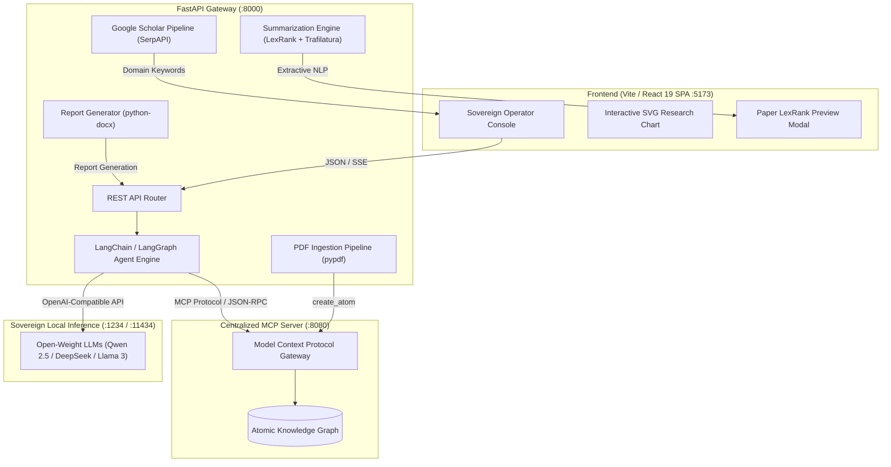

<div align="center">

# 🏭 Sovereign On-Premise Agentic AI Workbench

### Using Open-Weight Multimodal LLMs for Confidential Industrial Work

*An air-gapped, agentic knowledge platform that keeps industrial intelligence inside the plant perimeter.*

[](https://www.python.org/)
[](https://fastapi.tiangolo.com/)
[](https://react.dev/)
[](https://vitejs.dev/)
[](https://www.langchain.com/langgraph)
[](https://modelcontextprotocol.io/)
[](https://www.docker.com/)
[](#-license)

[Overview](#-overview) •
[Architecture](#-system-architecture) •
[Features](#-key-features) •
[Quick Start](#-quick-start) •
[LLM Setup](#-connecting-your-llm) •
[API](#-api-reference) •
[Team](#-team)

</div>

---

## 📌 Overview

Industrial facilities such as chemical refineries, manufacturing plants and energy infrastructure produce large volumes of proprietary technical literature: standard operating procedures (SOPs), equipment specifications, safety manuals and maintenance records. Commercial cloud-hosted AI APIs conflict with air-gap compliance requirements and risk leaking confidential operational data.

The **Sovereign On-Premise Agentic AI Workbench** addresses this by running open-weight foundation models (**Qwen 2.5**, **DeepSeek**, **Llama 3**) entirely on local hardware. The models are connected to a centralized **Atomic Knowledge Graph** through the **Model Context Protocol (MCP)**, so plant engineers and operators can query, ingest and reason over their own documentation, with nothing leaving the internal network.

### The problem → our solution

| Problem | Our approach |
|:--|:--|
| Cloud LLMs risk exposing confidential plant data | Local inference via LM Studio / Ollama / vLLM |
| Technical PDFs are unsearchable silos | PDF → Knowledge Graph "atoms" ingestion pipeline |
| LLM answers are hard to trust in safety-critical settings | Auditable execution trace + academic grounding via Google Scholar |
| Engineers need deliverables, not chat logs | One-click Word (`.docx`) report generation |

---

## ✨ Key Features

- 🔒 **Sovereign Local Inference**: any OpenAI-compatible endpoint, hosted on-premise, with zero data exfiltration.
- 🤖 **Agentic Tool Calling**: a LangChain / LangGraph ReAct agent that autonomously chooses and calls tools.
- 🕸️ **MCP Knowledge Graph Interface**: `semantic_search`, `get_wiki` and `create_atom` over a JSON-RPC MCP client.
- 📄 **Technical Document Ingestion**: multi-page PDF → clean markdown → graph atoms (`pypdf`).
- 🎓 **Academic Grounding**: extracts domain keywords and correlates them with live Google Scholar literature (SerpAPI).
- 📊 **Research Coverage Chart**: an interactive SVG visualization of literature density per keyword.
- ✂️ **LexRank Summaries**: extractive summaries of cited papers (Trafilatura + Sumy + NLTK).
- 🧾 **Deterministic Report Generation**: executive summaries and verified calculations exported to `.docx`.
- 🔍 **Auditable Execution Trace**: step-by-step chain-of-thought and tool-call logs, viewable in the UI.
- 🛟 **Air-Gapped Fallback Mode**: the app keeps working (heuristic concept extraction + Scholar retrieval) even if no LLM server is running.

---

## 🏗 System Architecture



### Request flow

1. The operator authenticates and receives an isolated session token.
2. A natural-language query goes to `POST /agent/query`.
3. The LangGraph agent plans, calls MCP tools against the Knowledge Graph, and reasons with the local LLM.
4. Domain keywords are extracted and sent to Google Scholar for literature grounding.
5. The UI renders the answer, the execution trace, the research chart and paper cards.

---

## 🛠 Technology Stack

| Layer | Technologies |
|:--|:--|
| **Frontend** | React 19, TypeScript, Vite, custom glassmorphic CSS, responsive SVG data visualization |
| **Backend** | Python 3.11+, FastAPI, Uvicorn, AsyncIO, AIOHTTP |
| **Agentic framework** | LangChain, LangGraph (`create_agent`), LangChain-OpenAI |
| **Knowledge layer** | Model Context Protocol (MCP), Atomic Knowledge Graph |
| **Document / NLP** | PyPDF, python-docx, Trafilatura, Sumy (LexRank), NLTK |
| **Inference** | LM Studio, Ollama, vLLM (Qwen 2.5, DeepSeek, Llama 3) |
| **DevOps** | Docker, Docker Compose, Nginx |

---

## 📁 Project Structure

```text
sovereign-industrial-workbench/
├── backend/               # FastAPI gateway, agent engine, ingestion & summarization pipelines
│   ├── main.py            # Application entry point
│   ├── requirements.txt   # Python dependencies
│   └── .env               # LLM / MCP / port configuration (create from the table below)
├── frontend/              # React 19 + Vite single-page operator console
├── docker-compose.yml     # One-command full-stack deployment
├── .gitignore
└── README.md
```

---

## 🚀 Quick Start

### Prerequisites

- **Node.js** v18 or newer
- **Python** 3.10 or newer (3.11+ recommended)
- A local LLM runtime ([LM Studio](https://lmstudio.ai/) or [Ollama](https://ollama.com/)), see [Connecting Your LLM](#-connecting-your-llm)
- A running **MCP Knowledge Graph server** (default `http://localhost:8080/mcp`)
- *Optional:* [Docker Desktop](https://www.docker.com/products/docker-desktop/)

### Clone the repository

```bash
git clone https://github.com/vaibhav7549/sovereign-industrial-workbench.git
cd sovereign-industrial-workbench
```

### Method 1: Local development

**Terminal 1: Backend**

```bash
cd backend

# Create and activate a virtual environment
python -m venv venv
# Windows (PowerShell)
.\venv\Scripts\activate
# macOS / Linux
source venv/bin/activate

pip install -r requirements.txt
python main.py
```

- API: `http://localhost:8000`
- Interactive docs (Swagger): `http://localhost:8000/docs`

> **Windows tip:** if PowerShell blocks activation, run
> `Set-ExecutionPolicy -Scope Process -ExecutionPolicy Bypass` first.

**Terminal 2: Frontend**

```bash
cd frontend
npm install
npm run dev
```

Open **http://localhost:5173** in your browser.

### Method 2: Docker Compose

```bash
docker compose up --build
```

| Service | URL |
|:--|:--|
| Frontend UI | http://localhost:5173 |
| Backend API | http://localhost:8000 |
| Swagger docs | http://localhost:8000/docs |

```bash
docker compose down   # stop everything
```

---

## 🧠 Connecting Your LLM

The backend works with **any OpenAI-compatible endpoint**, configured in `backend/.env`.

<details open>
<summary><b>Option A: LM Studio (GUI, recommended on Windows)</b></summary>

1. Install LM Studio and download a model, e.g. `Qwen2.5-7B-Instruct-GGUF` or `DeepSeek-R1-Distill-Qwen-7B`.
2. Open the **Developer / Local Server** tab and click **Start Server** on port `1234`.
3. Configure:

```env
LLM_BASE_URL=http://localhost:1234/v1
LLM_MODEL=qwen2.5-7b-instruct-1m
LLM_API_KEY=1234
```
</details>

<details>
<summary><b>Option B: Ollama (command line)</b></summary>

```bash
ollama run qwen2.5:7b
```

```env
LLM_BASE_URL=http://localhost:11434/v1
LLM_MODEL=qwen2.5:7b
LLM_API_KEY=ollama
```
</details>

<details>
<summary><b>Option C: Hosted provider (OpenAI / Groq / OpenRouter), only where policy allows</b></summary>

```env
LLM_BASE_URL=https://api.openai.com/v1
LLM_MODEL=gpt-4o-mini
LLM_API_KEY=<your-api-key>
```

> ⚠️ This breaks the air-gap guarantee. Use it for development and demos only.
</details>

<details>
<summary><b>Option D: Built-in air-gapped fallback</b></summary>

If no LLM server is reachable, the backend does **not** crash. It switches to **Sovereign Air-Gapped Fallback mode**: it extracts query concepts heuristically, runs Google Scholar retrieval, and shows a clear status notice in the UI.
</details>

> **Docker users:** containers cannot reach `localhost` on the host. Use `http://host.docker.internal:1234/v1` (LM Studio) or `:11434/v1` (Ollama), as set in `docker-compose.yml`.

---

## ⚙️ Configuration Reference

Create `backend/.env` with the following variables:

| Variable | Default | Description |
|:--|:--|:--|
| `HOST` | `0.0.0.0` | Backend host binding |
| `PORT` | `8000` | Backend port |
| `LLM_BASE_URL` | `http://localhost:1234/v1` | OpenAI-compatible inference endpoint |
| `LLM_MODEL` | `qwen2.5-7b-instruct-1m` | Model name loaded in the local engine |
| `LLM_API_KEY` | `1234` | API key for the inference endpoint |
| `MCP_URL` | `http://localhost:8080/mcp` | Atomic Knowledge Graph MCP server URL |
| `MCP_AUTH_HEADER` | `Bearer <your-mcp-token>` | Authorization header for the MCP server |
| `SERPAPI_KEY` | `<your-serpapi-key>` | SerpAPI key for Google Scholar search |
| `VITE_API_URL` | `http://localhost:8000` | Backend URL used by the frontend |

> 🔐 **Security note:** never commit real tokens or API keys. Keep `.env` in `.gitignore` and rotate any key that has been pushed to a public repository.

---

## 💡 Usage Walkthrough

1. **Authenticate**: enter an Operator ID (e.g. `operator.v_88`) and click **Authenticate Session**.
2. **Ask a question**: for example, *"What are the primary safety protocols for industrial catalytic hydrocrackers?"*. Open **View Execution Trace** to inspect the agent's reasoning and tool calls.
3. **Explore research grounding**:
   - Review the **Research Coverage Chart** under the answer.
   - Expand keyword pills under **RESEARCH PAPERS (SCHOLAR)** in the right panel.
   - Click ✨ on a paper to open the **LexRank extractive summary** modal.
4. **Ingest a document**: choose **Ingest Document** in the sidebar and upload a technical PDF. It is parsed, converted to markdown and pushed into the Knowledge Graph as an atom via MCP.
5. **Diagnostics**: use **Diagnostic Ping** to test sandboxed tool routing and session security.

---

## 📡 API Reference

| Endpoint | Method | Purpose |
|:--|:--|:--|
| `/` | `GET` | Health check, active model and runtime status |
| `/login` | `POST` | Authenticates an operator and issues a session UUID |
| `/agent/query` | `POST` | Agent reasoning loop, tool execution and keyword extraction |
| `/agent/summarize` | `POST` | Scrapes a paper URL and returns a LexRank extractive summary |
| `/agent/tool` | `POST` | Direct invocation of MCP Knowledge Graph tools |
| `/ingest/pdf` | `POST` | Multipart PDF upload, text extraction and MCP atom ingestion |
| `/dummy_tool` | `POST` | Air-gapped sandbox diagnostic routing check |

Full interactive documentation is available at **`/docs`** once the backend is running.

---

## 🔧 Troubleshooting

| Issue | Fix |
|:--|:--|
| **Port 8000 already in use** | Set `PORT=8001` in `backend/.env` and update `VITE_API_URL` in the frontend to match |
| **PowerShell script execution error** | `Set-ExecutionPolicy -Scope Process -ExecutionPolicy Bypass` |
| **Docker can't reach LM Studio / Ollama** | Use `host.docker.internal` instead of `localhost` in `LLM_BASE_URL` |
| **NLTK tokenizer warnings** | The backend auto-downloads `punkt` and `punkt_tab` on startup |
| **Agent returns fallback responses** | Confirm your LLM server is running and `LLM_BASE_URL` / `LLM_MODEL` are correct |
| **No Knowledge Graph results** | Verify the MCP server is running at `MCP_URL` and the auth token is valid |

---

## 🗺 Roadmap

- [ ] Multimodal input (engineering drawings, P&ID diagrams, equipment photos)
- [ ] Role-based access control per operator clearance
- [ ] Offline academic corpus to remove the SerpAPI dependency
- [ ] Persistent chat history and saved investigations
- [ ] Evaluation benchmark for domain-specific answer accuracy

---

## 👥 Team

**Mini Project**, Department of Information Technology
**Walchand College of Engineering, Sangli**

| Name | Roll No. |
|:--|:--|
| Ahaan Dhar | 246109020 |
| Sharvaj Sandeep Fulgaonkar | 246109030 |
| Vaibhav Krishna Chaudhari | 246109002 |

Repository maintained by [Vaibhav Chaudhari](https://github.com/vaibhav7549).

---

## 📚 Citation

If you reference this work, please cite it as:

```text
Dhar, A., Fulgaonkar, S. S., & Chaudhari, V. K. (2026).
Sovereign On-Premise Agentic AI Workbench using Open-Weight Multimodal LLMs
for Confidential Industrial Work. Mini Project, Department of Information
Technology, Walchand College of Engineering, Sangli.
```

---

## 📄 License

Distributed under the **MIT License**. Add a `LICENSE` file to the repository root so the license badge and terms resolve correctly.

---

<div align="center">

**Built with ❤️ at Walchand College of Engineering, Sangli**

⭐ Star this repo if you found it useful.

</div>
