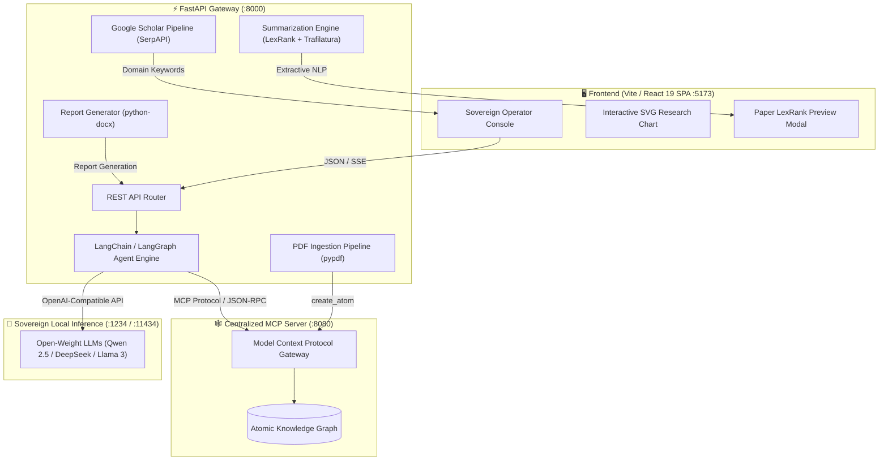

<div align="center">


### 🏭 Sovereign On-Premise Agentic AI Workbench
**Using Open-Weight Multimodal LLMs for Confidential Industrial Work**


[📌 Summary](#-executive-summary) · [🏗 Architecture](#-system-architecture) · [✨ Capabilities](#-core-capabilities) · [🚀 Run](#-how-to-run-the-application) · [🧠 LLM Setup](#-connecting-your-llm) · [📡 API](#-backend-api-endpoints) · [👥 Team](#-team)

</div>

---

## 📌 Executive Summary

Modern industrial facilities (chemical refineries, manufacturing plants, critical energy infrastructure) generate immense volumes of proprietary technical literature, standard operating procedures (SOPs) and equipment specifications. Commercial cloud-hosted AI APIs violate strict air-gap compliance and risk exposing confidential operational intelligence.

The **Sovereign On-Premise Agentic AI Workbench** is an enterprise-grade, air-gapped knowledge platform. It connects open-weight foundation models (**Qwen-2.5**, **DeepSeek**, **Llama-3**) to a centralized **Atomic Knowledge Graph** using the **Model Context Protocol (MCP)**.

> 🔒 **Zero data leaves your perimeter.** Models run on your own hardware, and every answer is traceable.

| | Highlight | What it gives plant engineers |
|:-:|:--|:--|
| 🛡️ | **Sovereign Local Inference** | Models hosted on-premise (LM Studio, Ollama or vLLM) with no data exfiltration risk |
| 🕸️ | **Centralized MCP Knowledge Graph** | Autonomous tool execution: `semantic_search`, `get_wiki`, `create_atom` |
| 📄 | **Technical Document Ingestion** | Industrial PDFs converted into graph atoms on the fly |
| 🎓 | **Academic Grounding** | Domain concepts extracted and correlated with live Google Scholar literature |
| 📊 | **Research Coverage & Synthesis** | Interactive literature-density charts and client-side LexRank summarization |
| 🧾 | **Deterministic Report Generation** | Executive summaries and verified calculations as downloadable Word (`.docx`) files |

---

## 🏗 System Architecture



---

## ✨ Core Capabilities

| Capability | Technical Mechanism | Industrial Value |
|:--|:--|:--|
| 🔒 **Air-Gapped Sovereign AI** | Open-weight models deployed locally via LM Studio / Ollama | Zero confidential data leaves the internal perimeter |
| 🤖 **Agentic Tool Calling** | LangChain / LangGraph ReAct orchestration | Autonomous query resolution and tool routing |
| 🕸️ **Knowledge Graph Interface** | Model Context Protocol (MCP) JSON-RPC client | Structured entity search and cross-linking across plant assets |
| 📥 **Automated Collateral Ingestion** | Asynchronous multi-page PDF ingestion (`pypdf`) | Converts SOPs into queryable graph nodes |
| 🎓 **Research Grounding** | Concurrent SerpAPI Scholar querying + LexRank | Validates engineering decisions against peer-reviewed literature |
| 🔍 **Auditable Execution Trace** | Granular chain-of-thought and tool step logging | Transparent verification of reasoning before plant deployment |

---

## 🛠 Technology Stack

| Layer | Technologies |
|:--|:--|
| 🎨 **Frontend** | React 19 · TypeScript · Vite · Vanilla CSS with glassmorphic styling · responsive SVG data visualization |
| ⚙️ **Backend** | Python 3.11+ · FastAPI · Uvicorn · AsyncIO · AIOHTTP |
| 🤖 **Agentic Framework** | LangChain · LangGraph (`create_agent`) · LangChain OpenAI |
| 📚 **Document Processing** | PyPDF · Python-docx · Trafilatura · Sumy · NLTK |
| 📦 **Containerization** | Docker · Docker Compose · Nginx |

---

## 📁 Project Structure

```text
sovereign-industrial-workbench/
├── 📂 backend/            # FastAPI gateway, agent engine, ingestion & summarization
├── 📂 frontend/           # React 19 + Vite operator console
├── 🐳 docker-compose.yml  # One-command full-stack deployment
├── 📄 .gitignore
└── 📘 README.md
```

---

## 🚀 How to Run the Application

You can run the workbench **locally (bare metal)** or with **Docker Compose**.

### Method 1: Local Development

**Prerequisites:** Node.js `v18+` · Python `3.10+` (3.11+ recommended)

```bash
git clone https://github.com/vaibhav7549/sovereign-industrial-workbench.git
cd sovereign-industrial-workbench
```

<table>
<tr>
<td width="50%" valign="top">

#### 🐍 Step 1: Backend (Terminal 1)

```bash
cd backend

# Create & activate a virtual environment
python -m venv venv
.\venv\Scripts\activate        # Windows
# source venv/bin/activate     # macOS / Linux

pip install -r requirements.txt

# Review LLM, MCP and port settings
# in backend/.env

python main.py
```

- API → **http://localhost:8000**
- Swagger docs → **http://localhost:8000/docs**

> **PowerShell policy error?**
> `Set-ExecutionPolicy -Scope Process -ExecutionPolicy Bypass`

</td>
<td width="50%" valign="top">

#### ⚛️ Step 2: Frontend (Terminal 2)

```bash
cd frontend

npm install

npm run dev
```

- Open → **http://localhost:5173**

</td>
</tr>
</table>

### Method 2: Docker Compose

With [Docker Desktop](https://www.docker.com/products/docker-desktop/) installed, build and run everything with one command from the project root:

```bash
docker compose up --build
```

| Service | URL |
|:--|:--|
| 🖥️ Frontend UI | http://localhost:5173 |
| ⚡ Backend API | http://localhost:8000 |
| 📖 Swagger Docs | http://localhost:8000/docs |

```bash
docker compose down    # stop all containers
```

---

## 🧠 Connecting Your LLM

The workbench supports **any OpenAI-compatible endpoint**, configured in `backend/.env`.

<details open>
<summary><b>🅰️ Option A: LM Studio (recommended for Windows GUI)</b></summary>

1. Download and open [LM Studio](https://lmstudio.ai/).
2. Download an open-weight model (e.g. `Qwen2.5-7B-Instruct-GGUF` or `DeepSeek-R1-Distill-Qwen-7B`).
3. Open the **Developer / Local Server** tab (`<->` icon).
4. Select your model and click **Start Server** on port `1234`.
5. Set in `backend/.env`:

```env
LLM_BASE_URL=http://localhost:1234/v1
LLM_MODEL=qwen2.5-7b-instruct-1m
LLM_API_KEY=1234
```
</details>

<details>
<summary><b>🅱️ Option B: Ollama (recommended for command line)</b></summary>

1. Install [Ollama](https://ollama.com/) and run:

```bash
ollama run qwen2.5:7b
```

2. Set in `backend/.env`:

```env
LLM_BASE_URL=http://localhost:11434/v1
LLM_MODEL=qwen2.5:7b
LLM_API_KEY=ollama
```
</details>

<details>
<summary><b>🅲 Option C: Cloud provider (OpenAI / Groq / OpenRouter)</b></summary>

If cloud access is permitted, point to any hosted provider:

```env
LLM_BASE_URL=https://api.openai.com/v1
LLM_MODEL=gpt-4o-mini
LLM_API_KEY=sk-your-openai-key-here
```

> ⚠️ This breaks the air-gap guarantee. Use only where policy allows.
</details>

<details>
<summary><b>🅳 Option D: Built-in sovereign air-gapped fallback</b></summary>

If no local LLM server is active, **the application will not crash.** The backend automatically activates **Sovereign Air-Gapped Fallback mode**: it parses query concepts heuristically, executes Google Scholar retrieval, and shows a clear status notice.
</details>

---

## 💡 Step-by-Step Feature Walkthrough

Once both servers are running, open **http://localhost:5173**:

| Step | Action | What happens |
|:-:|:--|:--|
| **1️⃣** | **Authenticate Operator Session** | Enter an Operator ID (e.g. `operator.v_88`) and click **Authenticate Session**. The backend issues an isolated clearance token. |
| **2️⃣** | **Query the Knowledge Graph & Chat** | Type an industrial query (e.g. *"What are the primary safety protocols for industrial catalytic hydrocrackers?"*) and press Enter. Click **View Execution Trace** to inspect the chain-of-thought and tool calls. |
| **3️⃣** | **Explore Research Grounding** | Use the **Research Coverage Chart** under the answer. In the right panel, click a keyword pill under **RESEARCH PAPERS (SCHOLAR)** to expand paper cards. Hover for live previews and click ✨ for the **LexRank Extractive Summary** modal. |
| **4️⃣** | **Ingest Technical Documents** | Click **Ingest Document** in the sidebar and select a PDF. The backend extracts text with `pypdf`, converts it to clean markdown sections and pushes an atom into the Knowledge Graph via MCP. |
| **5️⃣** | **Diagnostic Sandbox Ping** | Click **Diagnostic Ping** to test isolated backend tool routing and session security. |

---

## ⚙️ Configuration Reference

All settings live in `backend/.env`.

| Variable | Default Value | Description |
|:--|:--|:--|
| `HOST` | `0.0.0.0` | Backend host binding |
| `PORT` | `8000` | Backend port |
| `LLM_BASE_URL` | `http://localhost:1234/v1` | OpenAI-compatible endpoint (LM Studio / Ollama / vLLM) |
| `LLM_MODEL` | `qwen2.5-7b-instruct-1m` | Open-weight model name loaded in the local engine |
| `LLM_API_KEY` | `1234` | API authorization key for the inference endpoint |
| `MCP_URL` | `http://localhost:8080/mcp` | Centralized Atomic MCP server URL |
| `MCP_AUTH_HEADER` | `Bearer <your-token>` | Authorization token for the MCP server |
| `SERPAPI_KEY` | `<your-serpapi-key>` | SerpAPI key for Google Scholar academic search |
| `VITE_API_URL` | `http://localhost:8000` | Frontend → backend gateway URL |

> 🔐 **Never commit real tokens or API keys.** Keep `.env` in `.gitignore` and rotate any key that was ever pushed publicly.

---

## 📡 Backend API Endpoints

| Method | Endpoint | Purpose |
|:-:|:--|:--|
| `GET` | `/` | Health check, active model and runtime endpoint status |
| `POST` | `/login` | Authenticates operator username and issues a session UUID |
| `POST` | `/agent/query` | Agent reasoning loop, tool execution and keyword extraction |
| `POST` | `/agent/summarize` | Scrapes paper URLs and produces a LexRank extractive summary |
| `POST` | `/agent/tool` | Direct invocation of MCP Knowledge Graph tools |
| `POST` | `/ingest/pdf` | Multipart PDF upload, text extraction and MCP atom ingestion |
| `POST` | `/dummy_tool` | Verifies air-gapped sandbox diagnostic routing |

Interactive docs are available at **`/docs`** while the backend is running.

---

## 🔧 Troubleshooting FAQ

<details>
<summary><b>Port 8000 is already in use</b></summary>

Change `PORT=8001` in `backend/.env` and update `VITE_API_URL=http://localhost:8001` in `frontend/src/App.tsx`.
</details>

<details>
<summary><b>PowerShell script execution error</b></summary>

Run `Set-ExecutionPolicy -Scope Process -ExecutionPolicy Bypass` in your PowerShell window before activating the virtual environment.
</details>

<details>
<summary><b>Docker cannot reach local LM Studio / Ollama</b></summary>

Use `http://host.docker.internal:1234/v1` (or `:11434`) as defined in `docker-compose.yml` so containers can reach the host machine.
</details>

<details>
<summary><b>NLTK tokenizer warnings</b></summary>

The backend automatically downloads missing `punkt` and `punkt_tab` datasets at startup and inside Docker.
</details>

---

## 👥 Team

<div align="center">

**Department of Information Technology**
**Walchand College of Engineering, Sangli**

| 👤 Name | 🎓 Roll No. |
|:--|:-:|
| **Ahaan Dhar** | 246109020 |
| **Sharvaj Sandeep Fulgaonkar** | 246109030 |
| **Vaibhav Krishna Chaudhari** | 246109002 |

</div>

---

## 📚 Project Citation

> **Sovereign On-Premise Agentic AI Workbench using Open-Weight Multimodal LLMs for Confidential Industrial Work**
> Mini Project · Department of Information Technology · Walchand College of Engineering, Sangli

<div align="center">


⭐ **If you find this project useful, give it a star!** ⭐

</div>
