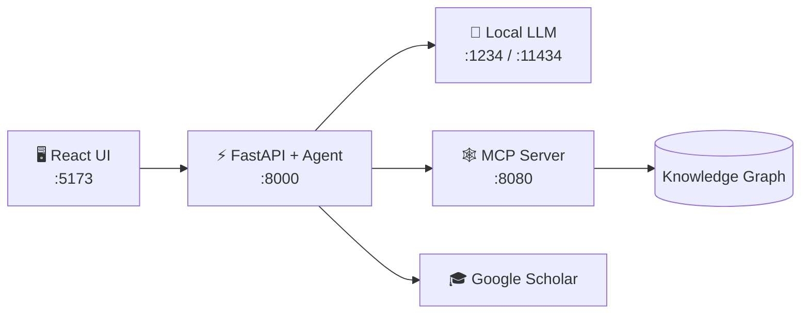

<div align="center">

# 🏭 Sovereign Industrial Workbench

**An on-premise AI assistant for confidential industrial work.**
Local LLMs + Knowledge Graph + Research grounding. Nothing leaves your plant.


</div>

---

## 💡 Why this project?

Plants and refineries hold sensitive manuals, SOPs and specs. Cloud AI tools risk leaking them. This workbench runs **open-weight models (Qwen, DeepSeek, Llama) locally**, so engineers can ask questions about their own documents with zero data leaving the network.

## ✨ What it does

| | Feature | Description |
|---|---|---|
| 🔒 | **Local inference** | Works with LM Studio, Ollama or vLLM |
| 🤖 | **Agentic reasoning** | LangGraph agent picks and calls tools by itself |
| 🕸️ | **Knowledge Graph** | Search and create knowledge via the Model Context Protocol (MCP) |
| 📄 | **PDF ingestion** | Turns technical PDFs into searchable graph nodes |
| 🎓 | **Research grounding** | Finds related Google Scholar papers and summarizes them (LexRank) |
| 🧾 | **Report export** | Generates Word (`.docx`) reports |
| 🔍 | **Execution trace** | See every reasoning step and tool call |

## 🏗 Architecture



## 🚀 Quick start

**Requirements:** Python 3.10+, Node.js 18+, a local LLM server, and an MCP server at `localhost:8080`.

```bash
git clone https://github.com/vaibhav7549/sovereign-industrial-workbench.git
cd sovereign-industrial-workbench
```

<table>
<tr>
<td width="50%" valign="top">

**🐍 Backend**
```bash
cd backend
python -m venv venv
venv\Scripts\activate      # Windows
# source venv/bin/activate # Mac/Linux
pip install -r requirements.txt
python main.py
```
→ `http://localhost:8000/docs`

</td>
<td width="50%" valign="top">

**⚛️ Frontend**
```bash
cd frontend
npm install
npm run dev
```
→ `http://localhost:5173`

</td>
</tr>
</table>

**🐳 Or run everything with Docker:**
```bash
docker compose up --build
```

## ⚙️ Configure your LLM

Edit `backend/.env`:

```env
# LM Studio                       # Ollama
LLM_BASE_URL=http://localhost:1234/v1     # http://localhost:11434/v1
LLM_MODEL=qwen2.5-7b-instruct-1m          # qwen2.5:7b
LLM_API_KEY=1234                          # ollama

MCP_URL=http://localhost:8080/mcp
MCP_AUTH_HEADER=Bearer <your-token>
SERPAPI_KEY=<your-serpapi-key>
```

> 💡 No LLM running? The app still works in **air-gapped fallback mode** (keyword extraction + Scholar search).
> 🐳 In Docker, use `host.docker.internal` instead of `localhost` for the LLM URL.
> 🔐 Never commit real keys. Keep `.env` out of Git.

## 🎮 How to use

1. **Log in** with any Operator ID (e.g. `operator.v_88`)
2. **Ask** an industrial question, e.g. *"Safety protocols for catalytic hydrocrackers?"*
3. **Inspect** the answer with *View Execution Trace*, the research chart and paper summaries (✨)
4. **Ingest** a PDF from the sidebar to add it to the Knowledge Graph

## 📡 API at a glance

| Endpoint | Purpose |
|---|---|
| `POST /login` | Start an operator session |
| `POST /agent/query` | Ask the agent |
| `POST /agent/summarize` | Summarize a paper |
| `POST /agent/tool` | Call an MCP tool directly |
| `POST /ingest/pdf` | Upload a PDF into the graph |

## 👥 Team

**Department of Information Technology, Walchand College of Engineering, Sangli**

| Name | Roll No. |
|---|---|
| Ahaan Dhar | 246109020 |
| Sharvaj Sandeep Fulgaonkar | 246109030 |
| Vaibhav Krishna Chaudhari | 246109002 |

<div align="center">

⭐ *Star the repo if you like it!*

</div>
