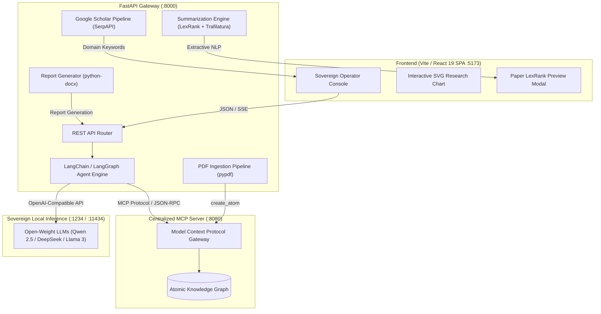

# Sovereign On-Premise Agentic AI Workbench
> **Using Open-Weight Multimodal LLMs for Confidential Industrial Work**

[](https://www.python.org/)
[](https://fastapi.tiangolo.com/)
[](https://react.dev/)
[](https://vitejs.dev/)
[](https://www.docker.com/)
[](LICENSE)

---

## 📌 Executive Summary

Modern industrial facilities (chemical refineries, manufacturing plants, critical energy infrastructure) generate immense volumes of proprietary technical literature, standard operating procedures (SOPs), and equipment specifications. Standard commercial cloud-hosted AI APIs violate strict air-gap compliance and risk exposing confidential operational intelligence.

The **Sovereign On-Premise Agentic AI Workbench** is an enterprise-grade, air-gapped knowledge platform that interfaces open-weight foundation models (such as **Qwen-2.5**, **DeepSeek**, and **Llama-3**) with a centralized **Atomic Knowledge Graph** using the **Model Context Protocol (MCP)**. It equips industrial plant engineers and technical operators with:

- **Sovereign Local Inference**: Eliminates data exfiltration risks by hosting models on-premise (via LM Studio, Ollama, or vLLM).
- **Centralized MCP Knowledge Graph**: Autonomous tool execution for semantic graph lookup (`semantic_search`, `get_wiki`, `create_atom`).
- **Technical Document Ingestion**: Converts complex industrial PDF documentation into graph atoms on the fly.
- **Academic Grounding**: Automatically extracts domain concepts and correlates findings with live Google Scholar literature.
- **Dynamic Research Coverage & Synthesis**: Visualizes literature density with interactive charts and performs instant client-side LexRank extractive summarization.
- **Deterministic Report Generation**: Compiles executive summaries and verified mathematical calculations into downloadable Word (`.docx`) collateral.

---

## 🏗 System Architecture



---

## ✨ Core Capabilities

| Capability | Technical Mechanism | Industrial Value |
| :--- | :--- | :--- |
| **Air-Gapped Sovereign AI** | Open-weight models deployed locally via LM Studio / Ollama | Zero confidential data leaves internal perimeter |
| **Agentic Tool Calling** | LangChain / LangGraph ReAct orchestration | Autonomous query resolution and tool routing |
| **Knowledge Graph Interface** | Model Context Protocol (MCP) JSON-RPC client | Structured entity search and cross-linking across plant assets |
| **Automated Collateral Ingestion** | Asynchronous multi-page PDF ingestion (`pypdf`) | Converts standard operating procedures into queryable graph nodes |
| **Research Grounding** | Concurrent SerpAPI Scholar querying + LexRank | Validates engineering decisions against peer-reviewed literature |
| **Auditable Execution Trace** | Granular chain-of-thought and tool step logging | Transparent verification of reasoning before plant deployment |

---

## 🛠 Technology Stack

- **Frontend**: React 19, TypeScript, Vite, Vanilla CSS with custom glassmorphic styling, responsive SVG data visualization.
- **Backend**: Python 3.11+, FastAPI, Uvicorn, AsyncIO, AIOHTTP.
- **Agentic Framework**: LangChain, LangGraph (`create_agent`), LangChain OpenAI.
- **Document Processing**: PyPDF, Python-docx, Trafilatura, Sumy, NLTK.
- **Containerization**: Docker, Docker Compose, Nginx.

---

## 🚀 How to Run the Application

You can run the workbench either **Locally (Bare Metal)** or with **Docker Compose**.

---

### Method 1: Local Development (Bare Metal)

#### Prerequisites
- **Node.js**: `v18+` or `v20+` (Run `node -v` to verify)
- **Python**: `3.10+` or `3.11+` (Run `python --version` to verify)

> 💡 Open **two terminals** and run both columns below at the same time.

<table>
<tr>
<td width="50%" valign="top">

#### 🐍 Step 1: Start the Backend
**(Terminal 1)**

1. Navigate to the backend:
   ```powershell
   cd backend
   ```

2. Create and activate a virtual environment:
   ```powershell
   python -m venv venv
   .\venv\Scripts\activate
   ```
   > If PowerShell shows a script execution policy error, run:
   > `Set-ExecutionPolicy -Scope Process -ExecutionPolicy Bypass`
   > then activate again.

3. Install backend dependencies:
   ```powershell
   pip install -r requirements.txt
   ```

4. Verify your environment file. The backend already includes a pre-configured `backend/.env` (LLM, MCP and port configuration). Inspect or modify it if needed.

5. Launch the backend API server:
   ```powershell
   python main.py
   ```

✅ Backend: **`http://localhost:8000`**
📖 API docs: **`http://localhost:8000/docs`**

</td>
<td width="50%" valign="top">

#### ⚛️ Step 2: Start the Frontend
**(Terminal 2)**

1. Open a **second** terminal and navigate to the frontend:
   ```powershell
   cd frontend
   ```

2. Install Node dependencies:
   ```powershell
   npm install
   ```

3. Start the Vite development server:
   ```powershell
   npm run dev
   ```

4. Open your browser and go to:
   ```
   http://localhost:5173
   ```

✅ Frontend: **`http://localhost:5173`**

</td>
</tr>
</table>

---

### Method 2: Running with Docker Compose

If you have [Docker Desktop](https://www.docker.com/products/docker-desktop/) installed, you can build and run both frontend and backend with a single command:

1. In the project root directory, run:
   ```bash
   docker compose up --build
   ```

2. Access the services:
   - **Frontend UI**: `http://localhost:5173`
   - **Backend API**: `http://localhost:8000`
   - **Swagger Docs**: `http://localhost:8000/docs`

3. To shut down the containers:
   ```bash
   docker compose down
   ```

---

## 🧠 Connecting Your LLM (Inference Options)

The workbench supports any OpenAI-compatible API endpoint via `backend/.env`:

### Option A: LM Studio (Recommended for Windows GUI)
1. Download and open [LM Studio](https://lmstudio.ai/).
2. Search and download an open-weight model (e.g. `Qwen2.5-7B-Instruct-GGUF` or `DeepSeek-R1-Distill-Qwen-7B`).
3. Click the **Developer / Local Server** tab (<-> icon).
4. Select your loaded model and click **Start Server** on port `1234`.
5. In `backend/.env`, set:
   ```env
   LLM_BASE_URL=http://localhost:1234/v1
   LLM_MODEL=qwen2.5-7b-instruct-1m
   LLM_API_KEY=1234
   ```

### Option B: Ollama (Recommended for Command-Line)
1. Install [Ollama](https://ollama.com/) and run:
   ```bash
   ollama run qwen2.5:7b
   ```
2. In `backend/.env`, set:
   ```env
   LLM_BASE_URL=http://localhost:11434/v1
   LLM_MODEL=qwen2.5:7b
   LLM_API_KEY=ollama
   ```

### Option C: Cloud Provider (OpenAI / Groq / OpenRouter)
If cloud access is permitted, you can point to any hosted provider:
```env
LLM_BASE_URL=https://api.openai.com/v1
LLM_MODEL=gpt-4o-mini
LLM_API_KEY=sk-your-openai-key-here
```

### Option D: Built-In Sovereign Air-Gapped Fallback
If no local LLM server is active, **the application will not crash**. The backend automatically activates its **Sovereign Air-Gapped Fallback mode**: it parses query concepts heuristically, executes Google Scholar retrieval, and provides a clear status notice.

---

## 💡 Step-by-Step Feature Walkthrough

Once both servers are running and you open `http://localhost:5173`:

1. **Authenticate Operator Session**:
   - On the login screen, enter an Operator ID (e.g., `operator.v_88`).
   - Click **Authenticate Session**. The backend issues an isolated clearance token.

2. **Query the Knowledge Graph & Chat**:
   - Type an industrial query in the bottom composer (e.g., *"What are the primary safety protocols for industrial catalytic hydrocrackers?"*).
   - Click Send (or press Enter).
   - Click **"View Execution Trace"** above the answer to inspect the agent's chain-of-thought and tool calls.

3. **Explore Google Scholar Research Grounding**:
   - Below the response, the interactive **Research Coverage Chart** plots academic literature density across keywords.
   - In the right-hand panel, click any keyword pill under **RESEARCH PAPERS (SCHOLAR)** to expand paper cards.
   - Hover over any paper to see live web-scraped previews.
   - Click the ✨ Sparkle button on a paper to open the **LexRank Extractive Summary Modal**.

4. **Ingest Technical Documents (PDF to KG Atom)**:
   - Click **"Ingest Document"** in the left sidebar navigation.
   - Select any technical PDF. The backend extracts text using `pypdf`, converts it into clean markdown sections, and pushes an atom into the centralized Knowledge Graph via MCP.

5. **Diagnostic Sandbox Ping**:
   - Click **"Diagnostic Ping"** in the left sidebar to test isolated backend tool routing and session security.

---

## ⚙️ Configuration Reference (`backend/.env`)

| Variable | Default Value | Description |
| :--- | :--- | :--- |
| `HOST` | `0.0.0.0` | Backend host binding |
| `PORT` | `8000` | Backend port |
| `LLM_BASE_URL` | `http://localhost:1234/v1` | OpenAI-compatible endpoint (LM Studio / Ollama / vLLM) |
| `LLM_MODEL` | `qwen2.5-7b-instruct-1m` | Open-weight model name loaded in local engine |
| `LLM_API_KEY` | `1234` | API authorization key for inference endpoint |
| `MCP_URL` | `http://localhost:8080/mcp` | Centralized Atomic Model Context Protocol server URL |
| `MCP_AUTH_HEADER` | `Bearer at_aoUQ...` | Authorization token for MCP server |
| `SERPAPI_KEY` | *(included demo key)* | SerpAPI key for Google Scholar academic search |
| `VITE_API_URL` | `http://localhost:8000` | Frontend backend gateway URL |

---

## 📡 Backend API Endpoints

| Endpoint | Method | Purpose |
| :--- | :--- | :--- |
| `GET /` | `GET` | Health check, active model, and runtime endpoint status |
| `POST /login` | `POST` | Authenticates operator username and issues session UUID |
| `POST /agent/query` | `POST` | Agent reasoning loop, tool execution, and keyword extraction |
| `POST /agent/summarize` | `POST` | Scrapes paper URLs and produces LexRank extractive summary |
| `POST /agent/tool` | `POST` | Direct invocation of MCP Knowledge Graph tools |
| `POST /ingest/pdf` | `POST` | Multipart PDF upload, text extraction, and MCP atom ingestion |
| `POST /dummy_tool` | `POST` | Verifies air-gapped sandbox diagnostic routing |

---

## 🔧 Troubleshooting FAQ

- **Port 8000 is already in use:**
  Change `PORT=8001` in `backend/.env` and update `VITE_API_URL=http://localhost:8001` in `frontend/src/App.tsx`.
- **PowerShell Script Execution Error:**
  Run `Set-ExecutionPolicy -Scope Process -ExecutionPolicy Bypass` in your PowerShell window before activating the virtual environment.
- **Docker cannot reach local LM Studio / Ollama:**
  Ensure you use `http://host.docker.internal:1234/v1` (or `11434`) as defined in `docker-compose.yml` so Docker containers can communicate with the host machine.
- **NLTK Tokenizer warnings:**
  The backend automatically downloads missing `punkt` and `punkt_tab` datasets at startup and inside Docker.

---

## 👥 Project Team

**Department of Information Technology, Walchand College of Engineering, Sangli**

| Name | Roll No. |
| :--- | :--- |
| Ahaan Dhar | 246109020 |
| Sharvaj Sandeep Fulgaonkar | 246109030 |
| Vaibhav Krishna Chaudhari | 246109002 |

---

## 📚 Academic Citation

Developed as a mini project for:
**Sovereign On-Premise Agentic AI Workbench using Open-Weight Multimodal LLMs for Confidential Industrial Work**
Department of Information Technology, Walchand College of Engineering, Sangli.
