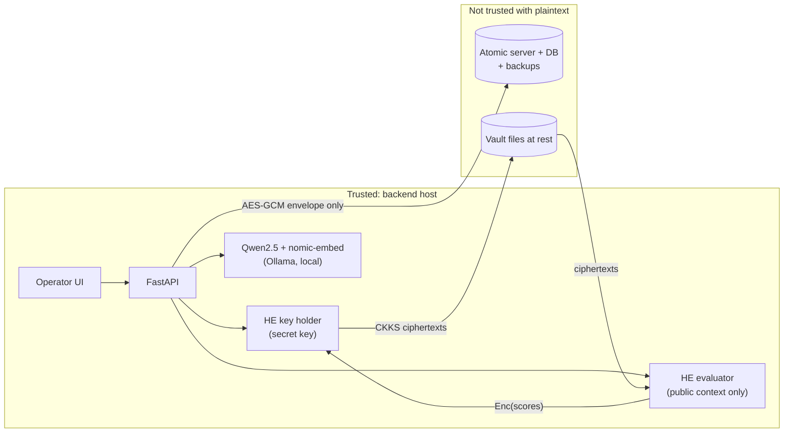

# Encryption Layer — Security Verification Report

**Project:** Sovereign On-Premise Agentic AI Workbench (SIH26117, Team 0x1F917)
**Scope:** Option A (CKKS homomorphic encryption for semantic search) + Option C (differential privacy on embeddings)
**Date:** 28 Oct 2026

> **Verification status.** Key management, DP, envelope, audit chain, leakage guards and the full ingest → search → decrypt orchestration are tested and passing (27 tests). The 8 real-CKKS tests and the API test are written but **have not run yet**: TenSEAL could not be installed in the build environment because PyPI access was blocked. Run them on the target VM (§9) before you claim the HE rows below.

---

## 1. What was built

```
backend/
  main.py                      7 entry-point functions + modified endpoints
  encryption/
    keys.py      master key → HKDF subkeys; AES-256-GCM with AAD; HMACs
    he.py        CKKS key holder (secret) / evaluator (public-only) on TenSEAL
    dp.py        Laplace mechanism (correct L1 sensitivity); Opacus DP-SGD hook
    vault.py     SQLite store: CKKS ciphertexts + sealed chunk text, HMAC-checked
    envelope.py  extraction, page-aware chunking, encrypted atom format for Atomic
    audit.py     HMAC-chained, plaintext-free audit log
    pipeline.py  ingest / search orchestration
    embedder.py  local embedding client (Ollama, OpenAI-compatible API)
  scripts/bench_he_latency.py   HE vs plaintext latency + accuracy benchmark
  scripts/bench_dp_utility.py   privacy/utility curve (synthetic or your real data)
  tests/                        unit + pipeline + real-CKKS + API tests
```

| Function (spec name) | Where | Notes |
|---|---|---|
| `setup_homomorphic_context()` | main.py → `he.HEKeyHolder.load_or_create` | N=8192, [60,40,40,60], scale 2^40, Galois + relin keys. The secret context is sealed with AES-GCM on disk. |
| `encrypt_embedding()` | main.py → `HEKeyHolder.encrypt` | Zero-pads 768→1024 so the encrypted dot product needs 10 rotations instead of 18. |
| `add_differential_privacy_noise()` | main.py → `dp.laplace_embedding` | Clips to the L2 unit ball. Noise is Laplace(0, 2√d/ε). Output is re-normalised. |
| `semantic_search_encrypted()` | main.py + LangChain tool | The evaluator computes Enc(⟨q,dᵢ⟩) using only the public context. Only the scores are decrypted. |
| `ingest_document_encrypted()` | main.py → `pipeline.ingest` | Pipeline: PDF/text → chunks → embed → DP → CKKS → vault, plus an AES-GCM envelope sent to Atomic. |
| `setup_privacy_engine()` | main.py → `dp.setup_privacy_engine_sync` | Opacus `make_private_with_epsilon`, RDP accountant, δ=1e-5. Optional install. |
| `decrypt_result()` | main.py | Key holder only. Every call is audited. |

Endpoints:
- `POST /ingest/pdf` encrypts when `ENCRYPTION_ENABLED=true` and runs the legacy path otherwise.
- `POST /agent/query` runs encrypted retrieval first, so the 3B model is always grounded. The tool stays available for follow-up searches.
- `POST /agent/verify-encryption` is new.
- `POST /agent/tool` now refuses `create_atom`/`update_atom`/`edit_atom`/`ingest_url` while encryption is on, because those would write plaintext into Atomic.

## 2. Trust boundary



The backend process and the local LLM have to see plaintext, because you cannot run Qwen on ciphertext. Everything that stores data is outside the trust boundary: Atomic, its SQLite/Postgres database and backups, and the vault files. The evaluator is too. It gets only the public context, and its code refuses a context that holds a secret key. So it could later run on a separate host without changing any code.

## 3. Changes from the spec, and why

| # | Spec said | Implemented | Reason |
|---|---|---|---|
| 1 | Store plaintext text chunks in Atomic | **Chunk text and title are AES-256-GCM encrypted before Atomic** | Atomic's source (`crates/atomic-server/src/mcp`) shows that `create_atom` takes only `content`/`source_url`. It then chunks the content, **embeds it with its own model**, auto-tags it with an LLM and stores plaintext vectors in `vec_chunks`. If we sent plaintext, "no plaintext embeddings in Atomic" would be false no matter what we encrypt. The old `title`/`tags` arguments were being silently dropped too. |
| 2 | Encrypted similarity search "at Atomic" | Search runs in the backend's evaluator, which holds the public context only | Atomic (Rust + sqlite-vec) cannot compute on CKKS ciphertexts. The property the spec wants (the compute party never sees the query or the embeddings) still holds. |
| 3 | `encrypted_embedding` hex inside the atom | Ciphertext goes to the local vault. The atom stores its SHA-256 and byte size. | One N=8192 ciphertext is about 300–400 KB. Inside an atom, Atomic would re-chunk and re-embed it, costing hundreds of embedding calls per chunk on a 1-core VM. |
| 4 | Laplace(0, 1.0/ε) | Laplace(0, 2√d/ε) | For unit-norm 768-d vectors, the L1 sensitivity is 2√768 ≈ 55.4, not 1. Scale 1/ε gives no ε-DP guarantee. |
| 5 | ε = 1.0 with "accuracy preserved" | Mechanism is exact for any ε. **ε is your decision (§6).** | At ε = 1, retrieval is no better than random (measured). The two requirements contradict each other. |
| 6 | Fernet key, `he_context.pkl` | Fernet-format master key → HKDF → AES-256-GCM with AAD. Context uses TenSEAL serialisation, sealed, written as `chmod 600`. | Unpickling a file executes code. AAD binds each ciphertext to its (doc, chunk), so a hostile store cannot swap chunks unnoticed. |
| 7 | Search step 4: fetch atoms from Atomic | Search never contacts Atomic | Otherwise Atomic would learn which documents matched each query (access-pattern leakage). |
| 8 | Bind-mount `/data/he_context.pkl` | Named volume `sovereign-crypto:/data` | Bind-mounting a host file that doesn't exist yet makes Docker create a **directory**, and startup fails. |
| 9 | `ENCRYPTION_MASTER_KEY=${ENCRYPTION_MASTER_KEY}` in compose `environment:` | Key read from `backend/.env` via `env_file` | That compose line overrides the env_file value with an empty string whenever the shell variable is unset. |
| 10 | opacus in requirements.txt | `requirements-dp-training.txt` (optional) | torch adds about 1 GB to the image and is not used at runtime. Full DP fine-tuning of Qwen2.5-3B needs about 12 GB for fp32 weights alone, which is not feasible on 1 CPU and 3.9 GB RAM. |
| 11 | — | Removed hard-coded MCP token and SerpAPI key from `main.py` defaults and `docker-compose.yml` | Credentials in source fail "no private keys leak". **Rotate both tokens**, because they are in your git history. |

## 4. Security validation checklist

Legend: ✅ verified by a passing test · 🟡 implemented and tested with the HE stand-in, real-CKKS test written but not yet run · ❌ not met as specified

| Check | Status | Evidence |
|---|---|---|
| No plaintext embeddings stored in Atomic | ✅ | `test_ingest_sends_no_plaintext_to_atomic`: every payload Atomic receives is scanned for chunk fragments and filenames. `plaintext_embedding: null`. The runtime `assert_no_plaintext` guard aborts ingestion before any send. |
| `encrypted_embedding` populated for every chunk | ✅ / 🟡 | Every chunk record carries `encrypted_embedding_ref` (sha256, bytes). Real ciphertext: `test_full_pipeline_with_real_ckks`. |
| Query encrypted before leaving the backend boundary | ✅ | Search makes zero Atomic calls (`test_search_returns_correct_document_and_never_calls_atomic`). The query goes only to the evaluator, as CKKS. |
| Decryption only at the response boundary | ✅ | Only `decrypt_scores` and the top-K `decrypt_text` calls decrypt. The evaluator has no key (`test_evaluator_cannot_decrypt` 🟡). |
| Audit logs capture metadata, no plaintext | ✅ | `test_audit_log_has_no_plaintext_and_verifies` and `test_audit_refuses_plaintext_fields`. The logger raises if a field is named `query`, `text`, `embedding` etc. |
| Audit log tamper-evident | ✅ | `test_audit_chain_detects_tampering`, `test_audit_deleting_a_line_breaks_chain` |
| DP noise always applied (when enabled) | ✅ | Applied to every stored chunk and every query. ε is recorded per chunk in the vault, the envelope and the audit log. |
| Homomorphic operations work on encrypted data | 🟡 | `test_encrypted_dot_matches_plaintext` (tolerance 1e-3, identical top-5) |
| Search results match plaintext baseline | ✅ without DP / ❌ at ε = 1 | CKKS error is about 1e-5 (expected; to be confirmed by the benchmark). With DP, results depend on ε (§6). |
| No private keys in logs or responses | ✅ | Responses and logs carry only `key_id` (an HKDF fingerprint) and the HE `context_id` (a hash of the public context). Init errors never format key material. |
| Wrong master key / tampered state rejected | ✅ / 🟡 | `test_wrong_master_key_cannot_decrypt`, `test_vault_tampering_is_detected`, `test_swapped_chunk_text_is_rejected`, `test_sealed_context_roundtrip_and_wrong_key` 🟡 |
| Fail closed when misconfigured | ✅ | Missing key → encrypted endpoints return 503. Nothing falls back to plaintext. `test_missing_master_key_fails_closed`. |
| Backward compatible | ✅ (by construction) | `ENCRYPTION_ENABLED=false` leaves the original code path untouched. |

**Test run (build environment, Python 3.13):** `27 passed, 9 skipped`. The skips are the 8 tests needing TenSEAL and the API test needing fastapi and the full requirements.

## 5. Performance

**Plaintext baseline (numpy, measured):** 100 chunks 0.02 ms · 750 chunks 0.25 ms · 5 000 chunks 1.37 ms.

**Encrypted search: not yet measured.** Run this on the deployment VM:

```bash
cd backend && taskset -c 0 python scripts/bench_he_latency.py --chunks 25 50 100 200 --json-out bench_he.json
```

It reports per-stage latency, ciphertext size, max error against plaintext, top-5 agreement, and how many chunks fit in a 5-second budget. What to expect, from SEAL operation costs (an estimate to replace with your numbers): one encrypted dot product costs one multiplication, one relinearisation and 10 rotations, roughly 20–35 ms per chunk on one Xeon core. The 5 s target therefore holds for about **150–250 chunks**, which is a few dozen typical PDFs. Ciphertexts take about 300–400 KB per chunk on disk and in the cache (`HE_CACHE_MAX_MB`).

Beyond that, the next steps in order of payoff are:
1. **Slot packing.** Four 1024-d chunks fit in one ciphertext, so one rotate-and-sum serves four chunks (about 4× faster). This needs SEAL's rotation API, which TenSEAL exposes only through `tenseal.sealapi`.
2. **Matryoshka truncation.** nomic-embed-text v1.5 can be cut to 256 dimensions: fewer rotations and a smaller key set.
3. **Tag-scoped search,** which reduces the number of candidate chunks.

## 6. Differential privacy: the decision you need to make

What ε means: for any two chunks *x*, *x′*, the probability of any output differs by at most a factor e^ε. That is 2.7× at ε = 1. It is **not** "a 63% probability of distinguishing", and no ε makes reverse-engineering "statistically impossible".

Measured on a synthetic 768-d corpus (300 passages, query–passage cosine 0.85; `docs/samples/dp_utility_synthetic.json`). Noise is applied to both the stored passages and the query:

| ε | noise scale b | recall@1 | recall@5 |
|---|---|---|---|
| 1 | 55.4 | 0.002 | 0.017 (random = 0.017) |
| 100 | 0.55 | 0.002 | 0.014 |
| 500 | 0.11 | 0.014 | 0.081 |
| 1 000 | 0.055 | 0.27 | 0.58 |
| 2 000 | 0.028 | 0.99 | 1.00 |
| 5 000 | 0.011 | 1.00 | 1.00 |
| ∞ (no DP) | 0 | 1.00 | 1.00 |

Real nomic-embed-text query/passage pairs have smaller margins than this synthetic set, so they will need a **larger** ε. Measure with your own documents before choosing:
`python scripts/bench_dp_utility.py --ollama http://localhost:11434 --pairs pairs.jsonl`

The underlying reason: DP hides whether one record influenced an output. Retrieval exists to find exactly one record. These goals conflict at small ε. Options to present honestly:
- **(a) Utility-preserving ε (~5 000–10 000 after measurement).** Formally a weak per-vector bound. In practice it is calibrated noise that blunts embedding-inversion attacks (vec2text-style) if the CKKS key ever leaks. Confidentiality comes from CKKS plus AES-GCM.
- **(b) ε = 1.0 as specified.** Strong formal bound, but search returns essentially random chunks.
- **(c) Training-time DP (Opacus, ε = 1, δ = 1e-5).** This is where "a specific document cannot be shown to be in the training set" actually applies. It protects fine-tuned weights, not stored embeddings.

## 7. Audit log sample

Full sample: `docs/samples/audit_log_sample.jsonl`. It was generated by the pipeline with the HE stand-in, so `he_context_id` reads `fakectx…`. The fields are identical with real CKKS.

```json
{"actor":"operator.v_88","event":"query_encrypted","query_fp":"25f0955fa759f91d","query_chars":24,"dp_applied":true,"dp_epsilon":5000,"ct_sha256":"3a20c367f7569c52","ct_bytes":6144,"key_id":"eb4142d4987e6d29","prev":"fd5e2559…","mac":"5acde677…","ts":"2026-10-28T08:19:20.683+00:00"}
{"actor":"evaluator","event":"he_similarity_computed","chunks":3,"secret_key_present":false,"he_context_id":"fakectx000000000","ms":0.22,"prev":"5acde677…","mac":"713e1298…"}
{"actor":"operator.v_88","event":"results_decrypted_at_boundary","returned":3,"searched_chunks":3,"chunk_uids":["a356e68d…:0","…"],"ms":{"homomorphic_dot_products":0.22,"decrypt_scores":0.2,"total":1.78},"prev":"713e1298…","mac":"fc5a1574…"}
```

`query_fp` is an HMAC under the audit key. An auditor holding the key can confirm that a given query was issued; nobody else can reverse it. What Atomic actually stores is in `docs/samples/atomic_envelope_sample.md`.

## 8. Residual risks (state these before a judge asks)

1. **Backend host compromise defeats everything.** The master key is in the process environment, and plaintext exists transiently in memory and in the LLM. There is no TEE (no SGX on the VM). Mitigations: lock down `.env` (0600), keep a separate offline key backup, use a non-root container user.
2. **Metadata still leaks to Atomic:** document count, chunk count, ingestion times, and padded text length in 256-byte buckets.
3. **Atomic features that read content** (auto-tagging, wiki synthesis, semantic edges, Atomic's own search) produce nothing useful for encrypted atoms. Disable auto-tagging on the Atomic database used for encrypted documents.
4. **CKKS is approximate, and decryptions can leak key material** if shared (Li–Micciancio 2021). Here, decrypted scores never leave the key holder. Only the top-K scores, rounded to 4 decimal places, reach the user.
5. **Not yet implemented:** key rotation and re-encryption; rebuilding the vault from Atomic envelopes; authentication beyond the demo UUID tokens. Tokens are also passed in URLs and so appear in access logs, and CORS is `*`.
6. **SerpAPI makes outbound internet calls,** which contradicts the air-gap claim. Disable it by leaving `SERPAPI_KEY` empty in air-gapped deployments.

## 9. How to run the remaining verification

```bash
cd backend
pip install -r requirements.txt                 # Python 3.11 (tenseal has no 3.13 wheels)
python -c "from cryptography.fernet import Fernet; print(Fernet.generate_key().decode())"   # → ENCRYPTION_MASTER_KEY in backend/.env
ollama pull nomic-embed-text
python -m pytest -q tests                        # expect 36 passed, 0 skipped
taskset -c 0 python scripts/bench_he_latency.py --json-out bench_he.json
docker compose up --build                        # then POST /agent/verify-encryption?token=...
```
